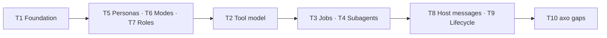

# Axome plan: adopting axo

This is the live planning document for adopting axo in Axome; the pinned revision is below. It changes freely as we work.

- **Goals & settled decisions:** [`design.md`](design.md)
- **Evidence:** [`research/`](research/README.md) (axo surveys, file:line cited)
- **Pinned axo:** `9dd6fa1` (adopted in [T13](#t13-axo-deda8e6-extensions-definitions-service-tiers): typed extension provenance, problems and package inspection on top of `118a716`). Earlier: `5c3f418` ([T11](#t11-axo-614089b-providers-login-and-the-live-catalog), `614089b` plus `SessionOptions::keywords_enabled`), Phase 2 Live Work (`97513d6`), [host capabilities](research/axo-cd12162/host-capability-handoff.md) (`cd12162`), [Phase 3](research/axo-b961066/host-capability-handoff.md) (`b961066`), and [snapshots and steer/queue control](#t10-remaining-axo-gaps) (`4d6bc34`, `a0ec20d`).

## How we work

- **One topic at a time**, in the order of the table below. For each topic: re-read its facts, answer its questions, record each answer as a decision in [`design.md`](design.md), then mark the topic **Decided**.
- **Questions keep their IDs** for the whole adoption, so notes and commits can refer to them. New questions get the next free number.
- **Facts come from axo source, not its docs.** If axo moves, re-survey the affected area into `research/axo-<rev>/` and update the facts here.
- **When a question needs axo work**, add it to [T10](#t10-remaining-axo-gaps) so requests to axo go out in batches.
- **Implementation starts per topic** once its decisions are recorded; the [mechanical migration](#mechanical-migration) can start as soon as T1 is decided.

## Topics

| Topic | Scope | Questions | Order | Status |
|---|---|---|---|---|
| [T1](#t1-foundation-config-storage-construction) | Config, storage, construction, supervision | Q1–Q4 | 1 | Decided |
| [T2](#t2-tool-model) | `kill`, `send`, `call`, deferred tools, tool cards, approval | Q5–Q10 | 3 | Implemented (Phase 2) |
| [T3](#t3-background-jobs) | Job surface, live output, wakes, closing with running jobs | Q11–Q16 | 4 | Implemented (Phase 2) |
| [T4](#t4-subagents-and-teams) | Children, teams, steering, results, sidebar | Q17–Q24 | 4 | Implemented (Phase 2) |
| [T5](#t5-personas) | Root agent per conversation, switching, authoring | Q25–Q28 | 2 | Implemented and verified (Phase 3 Stage A) |
| [T6](#t6-modes) | Plan/research modes, review, mode UI, keywords | Q29–Q35 | 2 | Implemented and verified (Phase 3) |
| [T7](#t7-models-and-roles) | `@role` selectors, roles UI, model picker | Q36–Q37 | 2 | Decided |
| [T8](#t8-host-messages-sections-dynamic-tools) | What Axome tells the model, custom message rendering | Q38–Q39 | 5 | Implemented (Phase 2) |
| [T9](#t9-session-lifecycle-and-status) | Context meter, cost, unloading, live-session registry | Q40–Q42 | 5 | Implemented (Phase 2) |
| [T10](#t10-remaining-axo-gaps) | axo gaps: accept, work around, or request | Q43 | 6 | Decided |
| [T11](#t11-axo-614089b-providers-login-and-the-live-catalog) | axo `614089b`: provider/login seam, live model catalog, layered writes | Q44–Q57 | 7 | Implemented; slice 8 landed with T13 |
| [T12](#t12-long-term-memory) | Native long-term memory (Basic Memory port) | Q58–Q62 (superseded) | 8 | Shipped off by default ([P31](design.md#decisions)) |
| [T13](#t13-axo-deda8e6-extensions-definitions-service-tiers) | axo `deda8e6` + ask documents (`9c1b4ad`): Bun extensions, live definitions, service tiers, origin-bound credentials, file records, `ask` | Q63–Q79 | 9 | Implemented at `9dd6fa1` ([P39](design.md#decisions)); Workspace Trust is roadmap Phase 4 |
| [T14](#t14-chat-ux-pass) | Setup footer, non-stopping dismiss, skill chip, Session panel, tab dot | n/a | 10 | Implemented at axo `c1b060a`; deferred items listed |
| [T15](#t15-composer-text-view) | Editable chips, file-type icons, Monaco text view for the composer | n/a | 11 | Implemented ([P44](design.md#decisions)); deferred items listed |

T5–T7 go together because they define the composer and the `/plan` story; T3 and T4 go together because jobs and children share one registry and probably one surface.

## Vocabulary

- **Persona:** the root agent definition. Replaces the system prompt body and shapes the tool set. Switched with `Session::set_agent`.
- **Mode:** an overlay on a root session. Adds instructions as a hidden message, limits which tools may run, may switch model on entry, and may end with the model handing back a result. Switched with `Session::set_mode`. Leaves the system prompt alone.
- **Model role:** `@name` in a model selector, mapped to a concrete model in user settings. `@plan` is a role, not an agent.
- **Deferred tool:** a tool the model can run but whose schema is not in the declared tool list. The model finds it through `tool://` and runs it through the `call` tool.
- **Job:** a row in a session's job registry: a background command (`bg_N`) or a child session (`agent_N`).

---

## Mechanical migration

Compile and correctness fixes with nothing to decide beyond T1. Evidence: [`research/axo-843cd73/compile-probe.md`](research/axo-843cd73/compile-probe.md) (38 errors: 28 production, 10 tests).

- [x] Construction: `Axo::builder(models, store)`, sync `build()`, `ConfigSource`; Axome keeps its own `Models` and settings (shape decided in T1).
- [x] Exhaustive matches: entries `job_start`, `child_start`, `job_end`, `agent_change`, `mode_change`; events `Job`, `JobGone`, `Context`, `AutoPaused`, `Mode`, `ModeResult`, `ModeResultResolved`; submission kinds `Mail`, `Quiet`; `CommandKind::Mode`; the new error variants in `axo_error`.
- [x] Flat `LiveSnapshot` (`snapshot.agent` is now the persona name).
- [x] `abort()` is sync; `NavigateOptions.focus`; `ModelsOptions.http_client` in tests.
- [x] Drop `lastLinePartial` from `payload.ts` and its test fixture (capped read/grep/find output currently loses structured rendering).
- [x] Forward `details` on partial tool updates (`live.rs:410-423`).

How each new entry, event and message renders is decided in its topic; the migration only makes the matches explicit.

---

## T1. Foundation: config, storage, construction

**Status:** Decided · **Evidence:** [`research/axo-6cdaeb4/config-and-embedding.md`](research/axo-6cdaeb4/config-and-embedding.md)

**What axo gives**
- `Axo::builder(Arc<Models>, Arc<dyn SessionStore>)` with `.config(ConfigSource)`, `.cache_dir`, `.name`, `.supervision`. axo no longer reads `~/.axo`.
- `ConfigSource` supplies `user()` and `project(cwd)` layers, including agent roots and mode roots. axo owns the settings schema, merging, trust filtering and `$VAR` expansion; user-only keys (`modelRoles`, `subagents`, `homeAgentsDir`, `project`) are ignored in project layers. `user()` is sampled at session create and open; there is no hot reload.
- No cache dir means no bundled docs scheme and no Nix dev-shell capture.
- `.name("axome")` renames the harness in the bundled prompts and the docs scheme (`axome://`).
- Supervision: process group (default, nothing to ship) or cgroup v2 (Axome's binary must route a supervisor entry in `main()`, and needs a delegated cgroup).
- axo-ai: Axome owns `Models`; config values starting with `!` are rejected, so command-based secrets resolve in Axome.

**Questions**
- **Q1.** Where do settings, models, credentials, sessions and cache live in Axome's data dir, and what happens to existing `~/.axo` sessions and `auth.json`: import once, read in place, or ignore?
- **Q2.** Harness name: call it `axome` in prompts and the docs scheme, or keep `axo`?
- **Q3.** Supervision: process group or cgroup?
- **Q4.** Settings UI scope: which axo settings Axome surfaces (retry, `bash.promoteAfterMs`, `subagents.*`, `modelRoles`), and where project trust decisions come from.

**Decisions:** [D1](design.md#decisions), [D2](design.md#decisions), [D3](design.md#decisions), [D4](design.md#decisions).

---

## T2. Tool model

**Status:** Implemented (Phase 2) · **Evidence:** [`research/axo-843cd73/tools.md`](research/axo-843cd73/tools.md)

**What axo gives**
- **`kill`** (`{id}`, `bg_N` or `agent_N`) and **`send`** (`{to, message, steer?}`) are tools; `proc://` and `agent://` are read-only. Killing a child stops its current run, not the child. No team-wide kill.
- **`call`** runs a deferred tool (`{tool, args}`). One call has two names: the assistant's tool call is `call`; execution events and the tool result carry the inner tool's name, with the same call id.
- **`tool://`** lists deferred tools; reading `tool://<name>` describes one and asks axo to promote it into the declared list on models that support mid-conversation tool changes. A hidden `tool_catalog` message tells the model when the deferred set changes.
- **Host tools:** `SessionOptions.tools: Vec<HostTool>`, each `HostTool::direct` or `HostTool::deferred`. Axome registers none today.
- **`ToolPolicy`** (replaces `tool_hooks`): async `before_tool_call` (Allow or Block; no argument rewrite) and `after_tool_call`, with a `ToolScope` (session, depth, persona, mode). Children inherit policies. No built-in approval protocol; a host builds one by awaiting inside the policy.
- **Result `details`:** bash `{exit, durationMs, fullOutput?}`, or `{job, fullOutput}` when promoted; spawn `{job}` or `{team, jobs}`; wait `{jobs}`; read, edit and write carry a ledger record. `kill`, `send` and `yield` have none.

**Where Axome stands**
- Tool cards are chosen from the assistant block's name (`turns.ts:69-80`), so every dispatched tool renders as a generic `call` card.
- `kill`, `send`, `spawn`, `wait`, `yield`, `enter_mode` and `call` have no cards.
- Bash footer parsing does not know the new stop wording; the typed `exit` makes the parsing unnecessary.

**Questions**
- **Q5.** Dispatched calls: show the inner tool's card (with a "via call" mark) or the outer `call`?
- **Q6.** Card set: which new tools get dedicated cards, and do job-related cards (promoted bash, spawn, wait, kill, send) link into the jobs and agents surface instead of repeating it?
- **Q7.** Replace bash footer text parsing with the typed `exit` and `durationMs`?
- **Q8.** Tool approval: do we want a permission system (per tool, per persona, per mode, per child), and what does the prompt look like? A whole feature, enabled by `ToolPolicy`.
- **Q9.** Host tools: which tools of its own does Axome offer the model (open in editor, show diff, notify, task list), and which are direct or deferred?
- **Q10.** Deferred catalog: user-visible anywhere, given a host read of `tool://<name>` triggers promotion?

**Decisions:** [D8](design.md#decisions), [D12](design.md#decisions), [D13](design.md#decisions), [D14](design.md#decisions), [D15](design.md#decisions).

---

## T3. Background jobs

**Status:** Implemented (Phase 2) · **Evidence:** [`research/axo-843cd73/host-surface.md`](research/axo-843cd73/host-surface.md), [`research/axo-6cdaeb4/jobs.md`](research/axo-6cdaeb4/jobs.md)

**What axo gives**
- Per-job events (`Job(JobInfo)` upsert, `JobGone`) and `snapshot.jobs`. A row has id, status (`Queued`, `Running`, `HelpersRunning`, `Finished`, `Failed`), `call_id`, `started_at`, and messages with delivery state. Command rows add label, tool, cwd, artifact, promotion cause and time, end time, and a typed exit (`exited`, `signaled`, `timedOut`, `killed{by}`, `aborted`, `interrupted`).
- `Session::command_output(call_id)`: a byte-offset progress watch plus range reads, continuous from foreground through promotion to exit. stdout and stderr are merged. Not restored after reopen; the artifact file stays readable.
- `Session::background(call_id)` (the user's "send to background") and `Session::kill_job(id)`.
- `jobs_from_entries(header, entries)` for closed sessions. A command that never ended shows as `Running` there until the session is opened and reconciled.
- Finished jobs wake an idle session and arrive as a `job_result` custom message whose details list the delivered message refs.
- `AutoPaused` event: job wakes are suppressed after an error or abort.

**Questions**
- **Q11.** Where jobs live in the UI: session bar, side panel, dock, or expandable inline cards. Per session only, or also a window-wide view across tabs?
- **Q12.** Terminal view: live output from the merged stream; scrollback size; what it shows after reopen (the static artifact).
- **Q13.** Delivered results in the transcript: today a muted notice. A proper "bg_1 finished" element linked to its row?
- **Q14.** The wake: a finished job starts a turn on its own. How the UI makes that legible, and how auto-pause is shown and cleared.
- **Q15.** Closing a tab or the app with running jobs: stop, keep the session alive, or block. Axome's idle unload would drop the session, which stops its commands and children [INFERENCE: read from code, not run].
- **Q16.** History views: how to label "was running when the session closed".

**Decisions:** [D12](design.md#decisions), [D16](design.md#decisions), [D17](design.md#decisions).

---

## T4. Subagents and teams

**Status:** Implemented (Phase 2) · **Evidence:** [`research/axo-843cd73/host-surface.md`](research/axo-843cd73/host-surface.md), [`research/axo-6cdaeb4/agents.md`](research/axo-6cdaeb4/agents.md)

**What axo gives**
- Children are job rows (`JobKind::Child`): session id, path, depth, persona, model, team ref, `resident`, and progress (`turns`, `max_turns`, `wrapping_up`, `yield_failures`, `usage`), pushed after each child assistant message. `Queued` is a real status.
- `Axo::session(child_id)` returns the live child; `child.attach()` is the same stream as a root, so a child renders as a chat and accepts steer, follow-up and abort.
- Host spawn: `Session::spawn`, `spawn_team`. `SpawnHook` (Allow, Block, Replace) for policy.
- Durable: `JobEnd.value` (typed yield result), `JobEnd.usage`, notes vs results, mail with sender.
- Opening a child file directly fails with `ChildSession { root }`; the host opens the root, then asks for the child. Read-only open works without the root.
- Not exposed: current tool and latest text on the parent row, queue position, live team state (who waits, pending mail, mutual wait), teammate mail and parent notes from the host, dismissing a row, tree usage rollup.

**Questions**
- **Q17.** Mental model: children as nested conversations (tree in the sidebar), rows in an agents panel, tabs, or split panes? What does a team look like?
- **Q18.** Depth of the live view: parent-row progress only, or attach each visible child for current tool and streaming text?
- **Q19.** User control: steer, follow up, stop a child run; can the user spawn a child, and from where?
- **Q20.** Results: how a child's result and structured value appear in the parent transcript, and how the user gets from the result to the child's transcript.
- **Q21.** Sidebar and history: child sessions appear in `list_sessions`; hide them, nest them under the root, and what a click does when the root is closed.
- **Q22.** Spawn approval: does `SpawnHook` drive a UI (confirm, pick the model, replace the agent) or stay silent?
- **Q23.** Cost: per-child and whole-tree usage (Axome sums it).
- **Q24.** Agent definitions: where they live (app data, project, both), whether Axome ships any, and whether there is an editor.

**Decisions:** [D12](design.md#decisions), [D18](design.md#decisions), [D19](design.md#decisions), [D20](design.md#decisions).

---

## T5. Personas

**Status:** Implemented and verified (Phase 3 Stage A; verification record in the roadmap's Phase 3 status) · **Evidence:** [`research/axo-843cd73/host-surface.md`](research/axo-843cd73/host-surface.md)

**What axo gives**
- `agent_change` entry; reopen restores the persona by name from the definitions loaded at that time. A missing definition gives a diagnostic and the session runs without it.
- `Session::set_agent(name | None)`: root only, allowed during a run, applies from the next request, and applies the persona's model selector if it has one. Clearing does not restore the previous model.
- `runAs: root | subagent | any` on definitions.
- `Axo::catalog(cwd, access, agents, modes)` lists agents, teams, modes, config and diagnostics without a session.
- Forks inherit the current persona.

**Questions**
- **Q25.** Is the persona a per-conversation choice (picker in composer or header), a per-project default, a global default, or all three?
- **Q26.** Does Axome ship a default persona of its own (its own system prompt)?
- **Q27.** Switching mid-conversation: how the transcript marks it, and how the user learns the model may change with it.
- **Q28.** Where personas are authored and stored, and their relation to T4's agent definitions (same files; `runAs` decides where each appears).

**Decisions:** [D5](design.md#decisions), [P17](design.md#decisions) (`defaultAgent` is an Axome-owned key inside `"axo"`).

---

## T6. Modes

**Status:** Implemented and verified on `b961066` (both Phase 3 stages; verification record in the roadmap) · **Evidence:** [`research/axo-843cd73/modes.md`](research/axo-843cd73/modes.md), [`research/axo-b961066/`](research/axo-b961066/host-capability-handoff.md)

Stage A on `cd12162` added mode commands, set-mode-then-steer with attachments intact, the selected/effective mode pill, non-plan review cards, composer keyword highlighting and frontmatter editing. Stage B adopts axo K and W from `b961066`: durable sent-message keyword chips, `plansDir`, bundled `/research` and `/plan*` modes, safe plan saving, and the Plan view with all five review actions.

**What axo gives** (surveyed at `843cd73`; historical where [T10](#t10-remaining-axo-gaps) records a later change: edited results, the effective-mode signal and recorded review outcomes arrived in `cd12162`)
- Definitions are markdown with frontmatter: `name`, `description`, `argument-hint`, `disable-model-invocation`, `model`, `tools.allow`, `tools.deny`, `result.schema`, `result.review`, `result.then`, plus free extra keys for host policy. Roots come from `ConfigSource` or `SessionOptions`. axo ships none.
- Enter with `Session::set_mode(Some(name))`, the `/name [prompt]` command through `Session::parse_command`, or the model's `enter_mode` tool (unless the mode disables model invocation). Leave with `set_mode(None)` or by the model finishing through `yield`.
- Effects: a hidden `mode_notice` message carrying the body; tool limits enforced at call time by tool name (not a shell sandbox); model and thinking switched on entry and restored on exit unless the user changed the model in between.
- Result review: with `result.review`, `yield` waits; the host gets `ModeResult { call_id, mode, result, awaiting_review }` and answers with `accept_result(call_id, message?)`, `revise_result(call_id, feedback)` or `dismiss(call_id)`. No way to accept an edited result. Pending reviews are in memory only. `result.then`, or the accept message, continues the run.
- State: the `mode_change` entry follows the branch; `SessionEvent::Mode`, `snapshot.mode`, `snapshot.pending_results`. These report the selected mode; nothing signals when it takes effect.
- Children spawned in a mode inherit its tool limits as a permanent ceiling, not its instructions.
- Mode and persona are independent; a mode cannot select a persona.

**Where Axome stands**
- Modes have their own composer group. The selected mode changes immediately; the effective mode changes at the next model request. Pending reviews recover from axo's journal on reopening.
- Plan drafts stay in `local://`, render live and open in the normal editor. Accepted plans are saved without overwriting an existing file, then optionally implemented in the same session, after compaction, or in a new chat.
- Native `write`/`edit` scopes follow child sessions. Read-only bash is a separate native restriction with writable scratch paths; projects under those paths are not protected from bash writes ([P18](design.md#decisions)).

**Questions**
- **Q29.** Which modes Axome ships (plan first), and what plan mode is: read-only tools, a `@plan` model role, a reviewed result that is the plan.
- **Q30.** "Plan mode with a plan agent": mode only, mode plus a persona switch (Axome does both), or persona only. Decides whether the system prompt changes.
- **Q31.** Review UI: where the plan is shown; approve, ask for changes, dismiss; what approval continues with (implement now, new session, hand to a child).
- **Q32.** Does the approved plan persist as its own object? axo keeps it only as the tool call's arguments.
- **Q33.** Mode indicator and exit control in the composer; how model-initiated entry (`enter_mode`) is shown or gated.
- **Q34.** Read-only really meaning read-only: tool-name limits still allow `bash`. Deny bash in plan mode, or add a `ToolPolicy`?
- **Q35.** User-defined modes: supported, where stored, and how they sit in the `/` picker next to skills and built-ins.

**Decisions:** [D6](design.md#decisions), [D7](design.md#decisions), [D8](design.md#decisions), [D9](design.md#decisions), [D10](design.md#decisions), [P17](design.md#decisions) (Q34 answered by axo-enforced `writes`, not a `ToolPolicy`), [P18](design.md#decisions) (native bash scratch-space exception retained and documented).

---

## T7. Models and roles

**Status:** Decided · **Evidence:** [`research/axo-6cdaeb4/agents.md`](research/axo-6cdaeb4/agents.md), [`research/axo-843cd73/modes.md`](research/axo-843cd73/modes.md) §1.5

**What axo gives**
- Selectors: `provider/model`, `@role`, `:thinking`, and combinations. `modelRoles` is a user-only setting. Personas, modes and `subagents.models` all take selectors.

**Questions**
- **Q36.** A roles screen in settings (default, plan, fast, …): which roles Axome defines and what uses them.
- **Q37.** The model picker offers concrete models only today; show roles too?

**Decisions:** [D11](design.md#decisions).

---

## T8. Host messages, sections, dynamic tools

**Status:** Implemented (Phase 2) · **Evidence:** [`research/axo-843cd73/host-surface.md`](research/axo-843cd73/host-surface.md)

**What axo gives**
- `Session::post(HostMessage { custom_type, text, display, delivery: Steer | FollowUp | Quiet })`: durable; `Quiet` never starts a run. Seven engine custom types are reserved.
- `set_section(name, body | None)` and `set_tools(...)`: root only, apply from the next request, must be supplied again on reopen.
- No `prepare_request` hook for hosts.

**Where Axome stands**
- Axome's notice wire type keeps only text, so job results, mail, notes and host messages all look alike.

**Questions**
- **Q38.** What Axome tells the model on its own (open file, selection, git state, UI events), and through which channel: quiet message, prompt section, or nothing.
- **Q39.** Rendering custom messages: how job results, mail, child notes and host messages are told apart.

**Decisions:** [D21](design.md#decisions), [D22](design.md#decisions).

---

## T9. Session lifecycle and status

**Status:** Implemented (Phase 2) · **Evidence:** [`research/axo-843cd73/host-surface.md`](research/axo-843cd73/host-surface.md)

**What axo gives**
- Context meter: `ContextUsage { tokens, window, trigger, reserve }` with `Context` events. Axome currently derives context from the last response's token count.
- Cumulative usage in the snapshot; per-run usage on `run_end`.
- `run_end.queued`: queued input survives reopen and is requeued without starting a run by itself.
- `/compact` and `/navigate` take a focus; compaction entries record reason and focus.
- No process-wide events on `Axo` and no list of live sessions.

**Questions**
- **Q40.** Context meter and cost display in the session bar.
- **Q41.** When Axome may unload a session, now that a session owns jobs and children (ties to Q15).
- **Q42.** Does Axome keep its own registry of live sessions for a window-wide activity view?

**Decisions:** [D17](design.md#decisions), [D20](design.md#decisions), [D23](design.md#decisions).

---

## T10. Remaining axo gaps

**Status:** Decided · **Handoff:** [`handoff/axo-pre-adoption-batch.md`](handoff/axo-pre-adoption-batch.md), [`handoff/axo-phase-3-batch.md`](handoff/axo-phase-3-batch.md) (fulfilled in `b961066`) · **Evidence:** [`research/axo-843cd73/host-surface.md`](research/axo-843cd73/host-surface.md) §7–8, [`research/axo-843cd73/modes.md`](research/axo-843cd73/modes.md) §7, [`research/axo-843cd73/tools.md`](research/axo-843cd73/tools.md) §7, [`research/axo-b961066/`](research/axo-b961066/host-capability-handoff.md)

Axome's 35-point request for a typed host surface (made against axo `6cdaeb4`) came back 14 shipped, 16 partly, 3 not shipped, 2 decided differently. What remains:

| Gap | State in axo | Axome impact |
|---|---|---|
| Ordered, timestamped event envelope | Not shipped; events are bare, only entries have seq and time | Re-attach still resyncs; a `Job` event can arrive before its `job_end` entry |
| Process-wide events, live session list | Not shipped | Axome keeps its own registry (Q42) |
| stdout/stderr separation | Merged stream | Terminal view cannot color stderr |
| Opening a child whose root is closed | Host opens root, then child | Axome orchestrates it (Q21) |
| Child row: current tool, latest text, queue position | Partly; turns and usage only | Attach children for rich rows (Q18) |
| Team live state, host mail and notes, dismissing a row | Partly | Team UI is roster plus per-child state |
| Command output after reopen | Artifact file only | Static view for old jobs (Q12) |
| Tree usage rollup | Per-run usage only | Axome sums (Q23) |
| Prompt and tool introspection with origin, config provenance, file ledger listing | Not shipped or partly | No "what the model sees" panel without more axo work |
| Host `prepare_request` hook, retry detail | Not shipped | Sections and quiet messages instead (Q38) |
| Mode: effective-mode signal, accept an edited result, durable review record | Not present | Shapes Q31–Q33 |
| **Pre-adoption blocker:** Side-effect-free tool & deferred-catalog inspection | `Session` has no public tools getter, and `Schemes::read("tool://<name>")` mutates promotion state | Request axo addition: `Session::tools()` returning direct/deferred/promoted/mode-restricted state, and keep host `Schemes::read` side-effect-free ([D15](design.md#decisions)) |
| Typed `kill`/`send` receipts, dispatch provenance on events | Not present | Shapes Q5–Q6 |
| **Pre-adoption blocker:** `AgentSpec.body` overwrites `<system>` | Root personas and spawned subagents both replace `SYSTEM.md`, losing harness mechanics (`local://`, resume, steering) | Request axo change: keep `<system>` strictly for `SYSTEM.md`/host override and place `AgentSpec.body` in its own `<agent>` section on both root and child sessions ([D5](design.md#decisions)) |
| **Pre-adoption blocker:** `:` disallowed in mode and skill names | `markdown::name_problems` permits `[a-z0-9-]` only | Request axo change: allow `:` namespace separators (`plan:roadmap`, `plan:step`, `review:adversarial`) ([D6](design.md#decisions)) |
| **Pre-adoption blocker:** Kernel-enforced read-only `bash` | Mode tool limits are name-only; no shell filesystem sandbox | Request axo feature: native Linux read-only `bash` execution mode (e.g. Landlock: writable `/tmp` + session `local/`, read-only everywhere else) usable by modes and subagents ([D8](design.md#decisions)) |
| **Pre-adoption blocker:** Magic keywords (`orchestrate`, …) | Not implemented in axo | Request axo feature: `KeywordSpec` (`keywords/*.md` + host specs), standalone lowercase prose matching, tool gates, optional thinking overrides, hidden per-turn notice injection, and `Catalog` metadata ([D10](design.md#decisions)) |
| Explicit `Session::resume_wakes()` for `auto_paused` | `auto_paused` clears on next user prompt; no dedicated host method | Request small axo helper so `SessionBar`'s `Resume` button clears `auto_paused` and delivers pending job results without sending a dummy prompt ([D16](design.md#decisions)) |
| ~~**Found in Phase 1:** no authoritative idle signal~~ | **Shipped in `cd12162`:** `SessionEvent::Activity` / `Session::is_running()` publish idle only after queued input and wakes drain | Adopted: `ChatLive.running/maintenance` follow `Activity`; the test fixture's snapshot polling is gone |
| **`cd12162` handoff, adopted in Phase 2** | stdout/stderr labels (`.log.streams`, `read_chunks`, `CommandOutput::open`); typed `SpawnReceipt`/`WaitReceipt`/`KillReceipt`/`SendReceipt`; `inspect_prompt`, `context_files`, `file_ledger`; `Retry` detail; `ConfigLayer.skill_roots` | Jobs view colours stderr including reopened logs; receipts parse typed details (wait reason shown); Context view adds Prompt, Context files and Files tabs; retry row on the running reply; `.axome/skills/` is a project skill root. Supersedes the "stdout/stderr separation", "typed kill/send receipts" and "prompt introspection" rows above |
| **`cd12162` handoff, for Phases 3 and 4** | `effective_mode` + `EffectiveMode`; `AcceptResultOptions { replacement, message }` with schema validation; `Session::send` + `SubmissionProvenance`; project skills and settings load at `ProjectAccess::Read` | Addenda in the roadmap's Phase 3 and Phase 4 sections list what each phase plan must verify and plan for; the Phase 3 items are settled in [P17](design.md#decisions). Supersedes the "Mode: effective-mode signal, accept an edited result" row above |
| **Phase 3 batch, shipped in `b961066`** | **K:** `Entry::Submission.keywords: Vec<String>` (fired names, deduplicated, text order, model-only included; old journals read empty). **W:** `writes: Option<Vec<String>>` on `ModeSpec`, `AgentSpec`, `ToolScope`, `SpawnLink`; entries are scheme URL prefixes or cwd-relative/absolute directories, absent unrestricted, `[]` none; enforced in `write`/`edit` by real path; effective scope is agent ∩ effective mode ∩ inherited ceiling, persisted on `SpawnLink`, `local://` meaning each child's own; does not restrict `bash` | Pin bumped; Stage B (keyword chip, bundled modes' `writes`, Toolbox `writes` line) uses the names as requested ([`research/axo-b961066/`](research/axo-b961066/host-capability-handoff.md)) |
| **Adopted from axo `4d6bc34`:** per-turn file snapshots & `write` diff metadata | `write` and `edit` record `details.change` (`FileChange`) with content-addressed `<session>/snapshots/<sha256>` blobs, `LineDiff` (`additions`, `deletions`, `firstChangedLine`, `patch`, `patchTruncated`), `Axo::{read_snapshot, squash_changes}`, `Session::{read_snapshot, squash_changes}`, and `axo::{file_change, squash}`. **Breaking:** `edit` dropped top-level `diff`/`patch`/`first_changed_line` | Adopted: `editDiff` / `toolHeader` read `details.change.diff`; transcript-only per-turn `N files changed +A -D [Review]` cards open Monaco `DiffStack` ([`handoff/axo-turn-diff-snapshots.md`](handoff/axo-turn-diff-snapshots.md)) |
| **Adopted from axo `a0ec20d`:** steer reliability & queue control | `abort` latches when pressed (not after settle); `resume_wakes` delivers held steers/follow-ups; queued steers settle pending `ask` & reviewed `yield` (`ResultResolution::Steered`); `steeringMode` defaults to `"all"`; `LiveSnapshot::queued: Vec<QueuedInput>` replaces `queued_steering`/`queued_follow_up`; `Session::withdraw` removes queued input & writes `Entry::SubmissionWithdrawn` | Pin bumped to `a0ec20d`; collapsible `QueuedMessages` card (`→` promote/interrupt-and-send, Edit prepending w/ `\n`, Cancel), double-Enter guard, and `whitespace: 'pre'` newline preservation landed ([`handoff/axo-steer-queue.md`](handoff/axo-steer-queue.md)) |
| **axo `614089b`:** provider/login/rewrite seam, models.dev v2 + Codex account catalog with refresh, layered write scopes, `withdraw` → `QueuedInput` | Shipped; Axome pins `5c3f418`, which builds on it | Adoption is [T11](#t11-axo-614089b-providers-login-and-the-live-catalog); registry change signal and logout requested in [`handoff/axo-models-batch.md`](handoff/axo-models-batch.md) |
| **axo `5c3f418`:** `SessionOptions::keywords_enabled` | Shipped; `false` loads no keywords for the session and its forks | The memory writer sets it, so keyword words quoted in a captured transcript never inject bodies or switch the writer off `@memory` |
| **axo `deda8e6` → `9dd6fa1`:** Bun extension bridge, `Definitions` and live registrations, registered commands, service tiers, origin-bound credentials, `details.files`, hardened delivery/ordering, ask documents, folder-scoped extensions, extension provenance, S/L/U, typed problems and package inspection | Adopted; Axome pins `9dd6fa1` | [T13](#t13-axo-deda8e6-extensions-definitions-service-tiers). Accepted upstream behaviors: successful withdrawal and delivery emit no `QueueChanged` (Axome refreshes the queue snapshot on those journal entries too), and ordinary JS exceptions from extension handlers reach the host as `<method> failed` |

**Questions**
- **Q43.** For each row: live with it, work around it in Axome, or send it back to axo before designing the UI that depends on it. Answer per row once the topics that depend on it are decided.

**Decisions:** [D24](design.md#decisions) — 12 items batched for axo in [`handoff/axo-pre-adoption-batch.md`](handoff/axo-pre-adoption-batch.md); remaining rows accepted/handled in Axome. [P17](design.md#decisions) — the Phase 3 batch (W, K) gated Stage B; [`handoff/axo-phase-3-batch.md`](handoff/axo-phase-3-batch.md) is fulfilled by `b9610666`; both Phase 3 stages are implemented and verified. [P18](design.md#decisions) records the accepted native bash scratch-space exception.

- To watch on first live use: Parallel returning excerpts next to the full page for focused `web_fetch` (`web/providers.rs`).

---

## T11. axo `614089b`: providers, login and the live catalog

**Status:** Slices 1–7 implemented; slice 8 awaits axo · **Evidence:** [`research/axo-614089b/`](research/README.md) (compile probe, provider/login, catalog, session/write-scope surveys; harness comparisons; Axome code answers; legacy journals) · **Handoff:** [`handoff/axo-models-batch.md`](handoff/axo-models-batch.md)

**What axo gives** (`a0ec20d..614089b`: `54dccae`, `0f4f890`, `614089b`)
- **Providers and login:** `Models::{register, unregister, reload, login}`; `ProviderLogin` + `LoginInteraction` (`open_url`, `device_code`, `prompt{secret}`, `select`, `progress`; cancel by dropping); `RequestRewrite`; `CodexLogin` replaces `auth::codex::{login, refresh}`; `ProviderInfo.oauth` → `login`; OAuth credentials gain `headers`/`baseUrl` (auth.json readable as is); requests resolve against the current registry (`Error::UnknownModel`).
- **Live catalog:** models.dev v2 (`models.dev.v2.json`, old cache ignored), the ChatGPT account's `/codex/models` list (fetched after login, offline floor otherwise), `Models::refresh` and a 2 h timer (`refreshInterval`, `catalogUrl`); open sessions adopt changed definitions at the next request, clamping thinking with an ordinary `ThinkingLevelChange`.
- **Sessions:** layered real-path write scopes (`WriteScope`; old persisted child ceilings no longer parse); `withdraw` returns `QueuedInput` with `custom`; delivery race and reentrancy fixes; accepted-review details in camelCase; `PipeChunk` capture; concurrent squash.
- **Breaking for Axome:** 7 production + 3 test compile errors ([`compile-probe.md`](research/axo-614089b/compile-probe.md)).

**Questions** (all answered)
- **Q44.** Registry lifetime and what Reload Models means → [P21](design.md#decisions).
- **Q45.** First-run catalog wait after the v1 → v2 cache change → [P21](design.md#decisions).
- **Q46.** Exposing refresh, interval, feed URL, freshness → [P21](design.md#decisions).
- **Q47.** Keeping frontend model lists current, including the post-login Codex list → [P22](design.md#decisions).
- **Q48.** Which login interactions Axome supports, and remote hosts → [P23](design.md#decisions).
- **Q49.** Provider card semantics now that `login` is not OAuth → [P24](design.md#decisions).
- **Q50.** Telling offline, unauthenticated and invalid config apart → [P24](design.md#decisions), [P21](design.md#decisions).
- **Q51.** A selected model that no longer exists → [P25](design.md#decisions).
- **Q52.** Grounded search auth and default model → [P26](design.md#decisions).
- **Q53.** Runtime providers and request rewrites → [P27](design.md#decisions).
- **Q54.** Automatic thinking clamps → [P27](design.md#decisions).
- **Q55.** Unknown and tiered prices, extended context → [P27](design.md#decisions); unknown-price support requested as optional item U.
- **Q56.** Child journals with legacy write ceilings → [P27](design.md#decisions).
- **Q57.** Queued custom host messages → [P27](design.md#decisions).

**Implementation**

Slices 1–7 run on `614089b`; slice 8 waits for the handoff.

1. **Pin bump and mechanical fixes.** Bump `Cargo.toml:28-30`; snapshot `Models::all()` at `providers.rs:13` and `mod.rs:688,696`; `withdraw(..).parts` at `mod.rs:1018` (ponytail comment: Axome posts no host messages, P27); `custom: None` in the three `convert.rs` queue fixtures. `login.rs:61` and `web/auth.rs:160` go away in slices 3 and 6. Update the `withdraw` signature in [`handoff/axo-steer-queue.md`](handoff/axo-steer-queue.md).
2. **Registry lifetime (P21).** Build the engine once per host; `models.jsonc`/`extendedContext` changes call `Models::reload` (error kept as `models_error`, last good registry kept); credential actions stop invalidating; **Refresh models** runs `reload` + `refresh` and reports errors; the model picker shows a loading state while the first catalog fetch runs.
3. **Generic login (P23).** `login.rs` implements `LoginInteraction` as a current-state view (`url`, `deviceCode`, `progress`, and at most one `prompt` or `select`). Questions await an answer by id; dropping the task cancels. Protocol, RPC, `backend.ts` and the Providers login dialog carry that view. The provider's prompt accepts a pasted redirect, with a loopback explanation on remote hosts. Any provider with `login` can start one.
4. **Provider cards (P24).** `login` replaces `oauth` on the wire; Log in and Add key independent; Remove/Log out only for stored credentials; environment hint; per-provider auth status from the backend (`available_models` already checks auth per provider: return the reason instead of dropping it).
5. **Model freshness (P22).** `HostEvent::ModelsChanged` (global, not folder-claimed) through desktop and server event mappings; emitted after key set/remove, login and Refresh models; the chat catalog cache, `axoModels` Settings states and Providers view refetch on it.
6. **Grounded search (P26).** `WebTools` gets the registry; grounded credentials via `Models::auth` for a registry model of the chosen provider; delete the Codex refresh in `web/auth.rs`; the grounded-model field resolves selectors (roles included) through `Models::find`; unset uses `@dash` when it lands on a grounded provider, else the hardcoded default.
7. **Unavailable model and copy (P25, P27).** Composer marks a selected model missing from the catalog as unavailable and blocks Send with a pick-another hint; `extendedContext` description explains the standard-price cap. README: login dialog, provider cards, Refresh models, `refreshInterval`/`catalogUrl`, grounded default.
8. **After the handoff lands.** Bump again; subscribe to `Models::subscribe` (S) and emit `ModelsChanged` from it; route Log out/Remove through `Models::logout` (L).

---

## T12. Long-term memory

**Status:** Shipped as native memory, off by default ([P31](design.md#decisions), superseding P28–P30). The Hindsight research below stays as evidence; its gates Q58–Q62 applied to a remote backend that Axome no longer uses. Workspace Trust gating of folder-level bank settings is tracked in `TODO.md`.

**Open questions / gates before enabling remote memory**

- **Q58. Deployment authority.** Where will credentials and the scope-bound broker live for each desktop/server principal, out of reach of model tools and repository code? Demonstrate real Workspace Trust and the code/web/admin split on the target deployment, not just in the isolated policy smoke. Until then: disabled.
- **Q59. Retrieval value.** On held-out decisions from more projects and dates, does ranking *approved note IDs* outperform searching the same local notes, with positive coverage ≥0.80, graded precision ≥0.70, zero forbidden output and on-demand p95 ≤2 s? Legacy-bank scores and a synthetic isolation check are not acceptance of the new corpus.
- **Q60. Forget and sharing.** Can deletion of one reviewed version be verified after an ambiguous retain acknowledgement, a late worker, or web recall of a code document? Qualify derivative/model refresh, backup expiry and already-delivered transcript limits before promising deletion outside the host.
- **Q61. Operating budget.** Does extraction **plus consolidation** of approved notes stay within the research budget on the single shared inference slot, including retries? Establish daily operator quota and energy/price accounting. Qualify cache loss on the actual target provider with deferred tools, compaction and resume.
- **Q62. Human scope mapping.** Which trusted worktrees, principals and deployments should share a note namespace, and does the user want code→web visibility for that scope? Require an explicit host-owned mapping; do not infer identity from repo text, basename, remote URL or a tag. Decide whether any legacy evidence warrants individual review; no bulk import.

---

## T13. axo `deda8e6`: extensions, definitions, service tiers

**Status:** Implemented at axo `9dd6fa1` ([P39](design.md#decisions)): everything below plus typed extension problems, provenance and package inspection. The deferred lifecycle hook stays open at the end · **Evidence:** [`research/axo-deda8e6/`](research/README.md) (compile probe, session API, behavior/data/config, providers/tiers, extensions; recommendations for tier UX, extension runtime inputs, management UX and the two-systems clash)

**What axo gives** (`5c3f418..deda8e6`, 9 commits: `cf6afa8`, `f47707e`, `f374d6c`, `3d4caa5`, `faabab4`, `60288a4`, `472844a`, `ef35935`, `deda8e6`)

- **Bun extensions (new crate `axo-extensions`).** Trusted TS/JS packages declared by `extension.json` contribute providers (models, login, request rewrite), tools, slash commands, tool-policy before/after hooks, spawn hooks, URL schemes, prompt sections, definitions (agents, teams, modes, keywords, skills) and journal observers. The host builds `Extensions::new(axo, ExtensionOptions)` with seven inputs (absolute `bun` path, ordered `roots`, `data_root`, `runtime_dir`, `env`, optional managed `store`, `auto_install`), passes the enabled list to `configure`, composes `SessionOptions::layer` before opening and `attach`es live sessions; axo reapplies layers on reconfigure. Manager surface: `status` (phases `Cold`/`Installing`/`Starting`/`Ready`/`Restarting`/`Disabled`/`Unavailable` with reasons), `collisions`, `diagnostics`, `subscribe`, `retry`, `reload`, `shutdown`, `memory` (PSS per runner). Installed packages: `install(folder, origin, replace_origin)`, `rollback`, `uninstall`, `install_dependencies`; acquisition is the host's. Extensions can call most of the `Session` API (prompt, steer, set model/mode/tier, answer, spawn, kill, navigate, custom state, posts), models (`complete`, `stream`) and guarded file/command helpers. Root create/open/fork/close go through an optional host `Lifecycle` hook (`&Caller`); without one they fail `no_lifecycle`. Code is unsandboxed; policy and spawn hooks fail closed; three runner failures in 300 s disable a placement. Unix-only (Unix sockets, 0700 dirs). ([`extensions.md`](research/axo-deda8e6/extensions.md))
- **Definitions and registrations.** `SessionOptions::{agents, modes, keywords}` become `definitions: Definitions` (adds `teams`, `skills`); `Axo::catalog` takes `&Definitions`. `Session::set_definitions` and `set_layer` change them live (precedence file > layer > host, first name wins; selected persona/mode keep their spec); no catalog-changed event. Host lists (tools, policies, spawn hooks, schemes, sections, commands) get live setters; forks keep the host/layer split, children get a joined snapshot. Definition getters return owned vectors. ([`session-api-and-definitions.md`](research/axo-deda8e6/session-api-and-definitions.md) §1–2)
- **Registered commands.** `RegisteredCommand` (handler gets `&Session` + argument text) via `SessionOptions::commands`, a layer, or `set_commands`; catalog order built-ins → modes → registered → skills; `CommandKind::Registered`; always `Alongside`. Static `Command::decode` stays built-in only; `Session::parse_command`/`run_command` resolve registered ones. `/tier` is a new built-in. (§3)
- **Service tiers.** `standard`/`flex`/`fast`/`ultrafast`; selectors accept a thinking and a tier suffix in either order (`model:high:fast`, `@role:flex`, `:fast`); `/tier`, `Session::set_service_tier`, `service_tier()`/`effective_service_tier()`; support and multipliers from models.dev, the Codex account list and `serviceTiers` in `models.jsonc`; user-only settings `serviceTier.onModelChange` (`reset`/`keep`) and `subagents.serviceTier` (`standard`/`inherit`); journal `service_tier_change` and `ThinkingLevelChange.{automatic, serviceTier}`; `AssistantMessage.service_tier` records the served tier and cost applies its multiplier; the hardcoded Codex tier pricing is gone; compaction stays standard. ([`providers-credentials-and-tiers.md`](research/axo-deda8e6/providers-credentials-and-tiers.md))
- **Providers and credentials.** Credential slots are per origin: `loaded/{id}` (built-in and `models.jsonc`), `registered/{owner}/{id}`, `layer/{owner}/{id}`; old bare-id entries stay in `auth.json` but are never read. `Models::credential_slot` exposes the current slot. `Models::register(owner, provider)`, owned `ProviderLayer::replace`, unavailable-provider reservations (`ProviderUnavailable`, nonretryable). `reload` is transactional; a failed `refresh` can still publish Codex/discovery changes. S, L and U landed later, in `118a716` (below).
- **File records.** Read/write/edit emit `details.files: [{ledger, change?}]` instead of top-level `details.ledger`/`details.change`; one call can carry several records; mutations that completed before an error or hard stop are kept on the error result; `FileChange.key` is base64url of native path bytes; `file_change` → `file_changes`. axo reads only the new envelope (ledger restore, compaction file lists, change extraction). ([`behavior-data-and-config.md`](research/axo-deda8e6/behavior-data-and-config.md) §3)
- **Session runtime.** Event receivers carry `Arc<SessionEvent>`; new `SessionEvent::QueueChanged`; delivery picks next work under one ownership lock (fewer transient idles); selection, mode and request-boundary transitions are serialized; `SessionInfo.modified` → `modified_at` (Unix ms); `SessionStore::read_page` and bounded wire pages; `Axo::observe_child` (no revival); `Axo::complete`/`stream` for one-off requests; `Session::render_skill`, `job_output`, `command_jobs`; `background(call_id)` promotes every command of the call; partial captures are marked failed and lose their full-output link; `Error::Completion { message, details }` and `Error::SkillNotFound`; `Tool::prompt_guidelines` returns `&[Cow<'static, str>]`; `WriteRoot` serializes as `{type, value}`.
- **Ask documents (`9c1b4ad`, after `deda8e6`).** `ask` takes one document: `blocks` in reading order, each `markdown` (`text`, passed through unparsed) or a question:
  - `choice`: `options` of `value`/`label`/`description`/`recommended`, `multi`;
  - `text`: `multiline`, `placeholder`, `prefill`;
  - `number`: `integer`, `min`, `max`, `default`.

  Every question has `id`, `question` and `optional`. Every choice accepts a free-text `other`. A `note` is allowed on choice and number answers, not text.
  - **Host contract:** `SessionEvent::QuestionPending { call_id, blocks }` and `LiveSnapshot::pending_questions` carry `Vec<AskBlock>`. `Session::answer(call_id, Vec<Answer { id, value, other, note }>)` validates against the document; an invalid submission returns `Error::InvalidInput` and stays pending.
  - **Result:** `details.answers`, keyed by id, each `{ value, other?, note? }` or `null` when skipped, plus `timedOut`. A timeout submits only `recommended`/`prefill`/`default`, `null` elsewhere. Dismissed, steered and cancelled keep their old behavior.
  - **Removed:** `Question`, option `preview`, question `header`, and the old `results`/`selectedOptions`/`customInput` details. `85059f4` changes only docs and expose-skip strings.
- **Requested fixes (`118a716`).** Verified against [`handoff/axo-deda8e6-batch.md`](handoff/axo-deda8e6-batch.md); all five items landed.
  - **F, folder scopes:** `Extensions::scope(ScopeOptions { key, roots, data_root, auto_install })` returns an `ExtensionScope` with its own `configure`, `status`, `collisions`, `diagnostics`, `subscribe`, `retry`, `reload`, `install_dependencies`, `memory` and `shutdown`.
    - Its runners are separate from the host-wide ones, and it has no store: installed packages are host-wide only.
    - `ExtensionScope::compose` sets the layer to host-wide extensions followed by the scope's, and sets the new `SessionOptions::models` to the scope's `Models` view. That view comes from `Models::scoped()`: same catalog, timer and credential store, with the scope's providers visible only to it. `attach` attaches through the scope.
    - A scoped extension can only act on sessions its scope owns, children included. Forks and children keep their root's scope.
    - `key` must be stable and unique among live scopes, with no `/` or whitespace; credentials are isolated by it.
    - The `Lifecycle` hook now returns `LifecycleSession { session, scope }` (unused while P36 stands). `Axo::spawn_parent(id)` gives a child's parent without reviving it.
  - **P, provenance:** `SubmissionProvenance` is now a tagged enum: `Agent { sessionId, route, name? }` or `Extension { id }`. Extension prompts, steers, follow-ups and posts record it, and `QueuedInput` carries it.
  - **S, change signal:** `Models::subscribe()` returns a `watch::Receiver<u64>` that bumps only when `all()` or `providers()` actually changed. Each scoped view has its own.
  - **L, logout:** `Models::logout(provider)` removes the credential from the current slot. For `openai-codex` it also drops the account model list and deletes `codex-models.json`. A failed file delete still logs out and returns the I/O error.
  - **U, unknown prices:** `Model.cost` and `Usage.cost` are `Option`. A model without feed prices is `None`, not $0, and a usage sum containing any unknown part is `None`. A `models.jsonc` cost patch on an unpriced model must give both `input` and `output`.
- **Not in this range.** Codemode, MCP and `ast_edit` remain deferred.

**What it touches in Axome**

- **Compile:** 20 production + 6 test errors at `deda8e6` ([`compile-probe.md`](research/axo-deda8e6/compile-probe.md) §1): guideline signatures (3; the staged, uncommitted `axome-browser` crate has a 4th at `tool.rs:200`), `Arc` events and models, `definitions` in chat, memory writer and tests, `catalog` arity, owned mode vectors, `modified_at`, `CommandKind::Registered`, `Entry::ServiceTierChange`, new error variants, tier fields in test literals. Further exhaustive matches the compiler had not reached: `QueueChanged` and `ServiceTierChange` in `live.rs` and the history reader. Not re-probed after `deda8e6`; from source:
  - `9c1b4ad` removes `axo::Question` (`convert.rs:867`) and changes the `Answer` fields (`convert.rs:886`) and the `QuestionPending` payload (`live.rs:718`).
  - `118a716` makes `Usage.cost` an `Option` (`convert.rs:141`) and `SubmissionProvenance` an enum (`convert.rs:746-750`).
- **Old journals and `118a716`:** routed `send`/`mail` submissions stored with the old provenance shape (no `kind` tag) no longer decode, so those submission entries read as unknown and lose their sender label (P32).
- **Silent frontend breaks:** `payload.ts`, `ToolDiff.svelte`, `toolHeader.ts`, `readOutput.ts`, `turnChanges.ts` and the Files panel (`sidebar/ledger.ts`) read the old singular fields, so new results lose inline diffs, turn-change cards, ledger paths and footer stripping. `turnChanges.ts` also takes only successful `edit`/`write`, one change each.
- **Existing users on upgrade:** OAuth logins and stored API keys stop authenticating (old slots ignored); Axome's own `provider_set_key`/`provider_remove` (`providers.rs:63-85`) still write and remove bare ids, so even keys saved after the bump would land in dead slots. `web:*` search keys are host-owned and unaffected. Child journals whose header has a nonempty old-shape write ceiling fail to parse and drop from listings (the second write-ceiling format change after P27). Old tool records keep rendering through today's parsers but axo no longer restores their ledger freshness (resumed sessions re-read before editing) or extracts their changes.
- **No current consumer:** the extension manager and lifecycle hook, layers and live setters, registered commands, tiers (catalog projection, `splitSelector`, picker, Settings, transcript), new settings keys (Axome's `AxoSettings` denies unknown fields), paging, child observation, one-off completions, completion error details.
- **Name clash:** Axome already has an "extensions" system (`extension.json` with languages, grammars, LSP servers, formatters, terminal harnesses; `dirs.data/extensions`), a different schema and lifecycle from axo's.
- **Packaging:** Bun ships only in the dev shell and frontend build; neither the desktop nor the server package provides a runtime Bun path.

**Answers** (IDs continue from Q62)

- **Q63. Credentials on upgrade.** Toph: no migration ([P32](design.md#decisions)). Everyone logs in again and re-enters keys. Axome's own bug gets fixed:
  - Add key writes to `Models::credential_slot(provider)` instead of the bare id.
  - Log out / Remove call `Models::logout(provider)`, which also clears the Codex account list.
- **Q64. Legacy session data.** Accepted, no migration ([P32](design.md#decisions)). Old child journals with old-shape write ceilings drop from history. Resumed old chats re-read files before editing.
- **Q65. File records in the UI.** In practice: when the agent touches a file, Axome shows it in three places. There's the diff under the edit/write call, the `N files changed +A −D [Review]` card at the end of the turn, and the Files tab in the sidebar. All three read two fields axo just replaced with one list (`details.files`). After the bump, new chats would show no diffs, no review card and no Files entries until Axome reads the list. Two real behavior changes come with it:
  1. One call can report several files. Only extension tools do this today.
  2. An edit interrupted *after* writing to disk now reports the change on the failed call. Today Axome hides diffs on failed calls, so you would see a red failed edit while the file had actually changed.

  **Answer (Axome's call):** read only `details.files` and render every record. Show changes from failed calls too, marked as from a failed call, because what's on disk is what matters. Count them in the turn card. Old chats lose their inline diffs (P32).
- **Q66. Service tiers.** UI work, handed off in [`handoff/ui-deda8e6.md`](handoff/ui-deda8e6.md) §1. One recommendation is recorded in [`service-tier-ux.md`](research/axo-deda8e6/service-tier-ux.md); the UI pass is not bound by it.
- **Q67. Live definitions.** Axome's call, nothing to decide. Bundled personas, modes and keywords move into `Definitions` one to one, and Axome never changes them live. The only live changes come from extensions, and every extension change goes through a manager call Axome makes (`configure`, `reload`, `retry`, `install`). After each one, Axome re-reads the command and toolbox catalogs of attached sessions. No axo catalog event needed.
- **Q68. Registered commands.** Axome's call. Axome registers no commands of its own. The composer lists registered commands (extensions') with their origin label. `ChatCommandKind` gains `Registered`. Command execution moves from the built-in-only static `Command::decode` to `Session::parse_command` + `run_command`, so extension commands actually run.
- **Q69. Extensions scope.** Toph: full support ([P33](design.md#decisions)).
- **Q70. Extension runtime inputs.** Recommendation ([`extension-runtime-inputs.md`](research/axo-deda8e6/extension-runtime-inputs.md)):
  - **Bun:** shipped inside every Axome package, found by one rule: `<directory of the Axome executable>/../lib/axome/bun`.
    - Nix desktop and server packages put a link to `${pkgs.bun}/bin/bun` there.
    - `.deb`/`.rpm` install Bun's binary there, patched to the system loader like `axome` itself.
    - Dev runs fall back to `bun` on PATH (the dev shell has it).

    Axome adds Bun's directory to the extensions' PATH so dependency scripts that call `bun` work. Missing Bun shows "Bun unavailable" and does not stop the app. Only the bundled Bun is used ([P35](design.md#decisions)).
  - **Directories:**
    - user authored root: `~/.config/axome/extensions`;
    - project root: `<folder>/.axome/extensions`, trusted folders only;
    - store: `dirs.data/axo/extensions/packages`;
    - data: `dirs.data/axo/extensions/data`;
    - runtime: `$XDG_RUNTIME_DIR/axome/ext`, with a private `/tmp` fallback (sockets are limited to 107 bytes);
    - env: Axome's base environment minus its own markers.
  - **Dependencies:** `auto_install` on, as axo's Phase 4 intends. Project roots only enter after D4 trust, so a folder can't run install scripts without trust.
  - **Lifetime:** one manager per host, owned by the engine next to `Axo` (P21), reconfigured from the settings watcher, attached on every root create/open/fork. It runs the same way on `axome-server`. No `Lifecycle` hook for now ([P36](design.md#decisions)).
  - **Project extensions (F, landed):** one `ExtensionScope` per trusted folder, created when the folder is opened and trusted, shut down when it closes or loses trust.
    - Roots: `<folder>/.axome/extensions`. Data: `dirs.data/axo/extensions/scopes/<key>`. The scope's `configure` gets the same user-only enabled list.
    - `key` is a stable hash of the canonical folder path, so credentials survive restarts.
    - Root sessions in that folder are composed and attached through the scope. Their model catalog, picker and change signal come from `scope.models()`, so a project extension's provider shows only in that folder.
    - Untrusted folders use the host-wide manager only.
- **Q71. Extension management UX.** UI work, defined by Toph's mockup (`/home/toph/Projects/ui.html`) and handed off with its facts, gaps and corrections in [`handoff/ui-deda8e6.md`](handoff/ui-deda8e6.md). Install sources (Toph): a folder on the host and a Git repository; no npm for now.
- **Q72. Two extension systems.** Toph: Axome's language, LSP, formatter and harness packages become **Integrations** ([P34](design.md#decisions)). The rename covers:
  - files: `integration.json`, `src-crates/axome-core/integrations/`, `dirs.data/integrations/`;
  - code: `Integration*` types, `integrations_*` RPCs, `features/integrations`;
  - UI: Reload Integrations.

  Ids and settings keys stay the same. "Extensions" means axo packages only. Clash inventory: [`extension-systems-clash.md`](research/axo-deda8e6/extension-systems-clash.md).
- **Q73. Lifecycle hook.** Deferred ([P36](design.md#decisions)), open issue below. The design from the Q70 research stays on file in [`extension-runtime-inputs.md`](research/axo-deda8e6/extension-runtime-inputs.md) § Lifecycle.
- **Q74. Extension activity in the UI.** Axome's call:
  - Tools and commands show their `extension <id>` origin.
  - Providers show their source on the Providers page.
  - Extension posts render as custom messages.
  - Prompts, steers and posts from an extension carry `SubmissionProvenance::Extension { id }` (P, landed), and the transcript shows "sent by `<id>`" (mockup board 10).
- **Q75. Queue events.** Axome's call. On `QueueChanged`, Axome re-reads the live queue (`Session::live().queued`) and replaces its queue rows, so axo's queue becomes the single source of truth. The entry-based rebuild in `live.rs` goes.
- **Q76. Optional new host capabilities.** Axome's call:
  - The jobs view opens output by job (`job_output`), not by call. One call can now own several commands, so this is a correctness fix.
  - Everything else has no consumer and stays unused. `observe_child` isn't needed because Axome only opens a child when the user does, and reviving it then is intended. Paging isn't needed because the history reader already streams. `Axo::complete`, `render_skill` and `Error::Completion` details belong to the one-off API Axome doesn't call; the new error variants map to the generic error.
- **Q77. Models handoff.** S, L and U landed in `118a716`, so T11 slice 8 joins this adoption:
  - `ModelsChanged` comes from `Models::subscribe()`, per scope for folders with one, replacing Axome's post-action refreshes.
  - Log out / Remove go through `Models::logout`.
  - Cost displays show "unknown" for `None` instead of $0, and totals containing an unknown part are unknown.
- **Q78. Ask documents.** In scope (`9c1b4ad`). UI defined by Toph's mockup `/home/toph/Projects/ask.html`, handed off in [`handoff/ui-deda8e6.md`](handoff/ui-deda8e6.md) §7. Axome replaces its whole ask path:
  - `convert::question`/`answer`;
  - `ChatQuestion*`/`ChatAnswer` in the protocol;
  - `AskPanel` (now `AskDocument`), `AskSummary` and `askResult.ts`.

  Old chats' ask cards lose their answers (P32).
- **Q79. Local images in chat Markdown.** Toph: show them on local desktop folders, including files outside the folder; leave remote as is ([P37](design.md#decisions)). This is Axome's own bug, but ask documents render Markdown with the same renderer, so it's part of this plan.
  - **The bug:** `` in a chat reply shows the webview's broken-image icon.
  - **Why:** `resolveMarkdownLocalPath` (`src/lib/utils/mediaAssets.ts:35`) reads a leading `/` as the project root, GitHub-style, so the path becomes `<folder>/repo/rust/Axome/src-tauri/icons/icon.png`.
  - **`file://` URLs:** passed through untouched on desktop, and the webview can't load them.
  - **No fallback on desktop:** "Local image unavailable" never shows, because the asset URL is always non-null.
  - **Fix (Axome's call):**
    - In chat (`MarkdownRenderer` with no `filePath`) on a local desktop folder, an absolute path or `file://` URL is a host path, mapped through the asset protocol, which already allows any path.
    - **Remote stays as is:** the server's project-only file reads (`validate_path`, `src-crates/axome-core/src/services/files.rs:845-858`) are not widened. Absolute or outside-folder images on the web client or in remote folders show "Local image unavailable". Toph is fixing remote issues separately. Desktop with an `axome://` folder also reads images from the local disk (`src/lib/platform/desktop.ts:140`) [INFERENCE from code]; that belongs with the remote work.
    - Markdown file previews keep `/` as the repo root.
    - `` gets an error fallback to "Local image unavailable".

**axo requests:** all fulfilled in `118a716` ([`handoff/axo-deda8e6-batch.md`](handoff/axo-deda8e6-batch.md)).

**Delivery (Toph):** one adoption covering everything, project extensions included, pinned at `9dd6fa1` (P39). Workspace Trust is not built here: every folder-scoped call goes through one `project_access(folder)` seam that returns `Trust` today, and roadmap Phase 4 replaces its body.

**Open**

1. **Extensions opening or closing chats (Q73).** Deferred; no realistic extension needs it yet. Without a hook, axo answers `no_lifecycle` and nothing happens. Adding a hook means deciding:
   - where a chat appears when it targets a folder with no tab, or another window;
   - who sees and owns a chat nobody is looking at;
   - how a close asks for consent when the chat has running work or an unsent draft.
2. ~~Logging in to a project extension's provider.~~ Settled (Toph): in the **This Project** section of Settings → Extensions, next to the extension that adds the provider ([P38](design.md#decisions)).

## T14. Chat UX pass

**Status:** Implemented · **Evidence:** [`.axome/research/chat-ux-boards-review.md`](../../.axome/research/chat-ux-boards-review.md), boards in `.bak/board2.html`, issues in `.bak/ISSUES.md`

**Shipped:** setup changes show in the answer footer instead of transcript lines; a pending-change bar above the composer; inline keyword marks; dismissing a question continues the run; the paused-wakes banner only when something is held; skill icon and chip; persona cards, the Session panel and `/persona`; the tab status dot at the end of the tab with a done-unread state; manual chat rename; steps derived from narration, with a per-turn summary.

**Deferred or pinned (decide before building):**

- **Agent-generated chat titles.** axo should own generation; the host may supply a guideline prompt; extensions must be able to shape or replace the result. Open: which model writes it and when. Until then a title is the first message or a manual rename. The muted "first words while generating" tab state from board 8 + 9 depends on this.
- **A generated icon per chat tab.** The icon set is a host concern, so the host has to hand its icon vocabulary to whatever picks one. Mechanism undecided.
- **Event-based pending bar.** The bar is a diff of the session's current persona, model and effort against the last committed reply, with no notion of who made a change or whether the in-flight request already uses it. While a request is in flight it can therefore name a persona, model or effort that request already uses, including changes the user did not make (a keyword's model switch on send, effort moved automatically by a model switch), and the same misattribution recurs between requests later in a turn until the next reply commits. Cancel is withheld while a turn runs so it cannot revert a running turn's setup; the text can still be wrong in that window. Proper fix: derive the bar from what is actually pending, either because axo exposes effective persona, model and effort as it does `effective_mode`, or by building it from change entries journaled after the latest request began, skipping automatic ones. Known gaps for the journal route: only `thinkingChange` carries `automatic` today (`modelChange` and `agentChange` do not), and axo's journaling order relative to request start is unverified. Needs its own plan.
- **Keyword match offsets from the backend.** Sent-message keyword marks are fetched per message through `keywordMatches` and cached in `UserBlock.svelte` for the app's lifetime. The proper shape is for the user entry to carry its match offsets, removing the cache and the call. Open points: `keyword_matches` currently requires a live session (`services/axo/mod.rs:1499`), and the frontend strips a leading skill name from the first text part, which shifts offsets. Needs its own plan.
- **Held teammate mail and quiet host messages** are not counted by the paused-wakes banner; axo does not expose them per session.
- **Other ISSUES workstreams, untouched:** surprise scroll jumps in the transcript; disabling individual models and whole providers; token and context efficiency for small-window models; a local feedback tool for the model to report harness problems; the Tauri `Canceled` unhandled rejection.

## T15. Composer text view

**Status:** Implemented · **Evidence:** [`.axome/research/composer-text-view.md`](../../.axome/research/composer-text-view.md), boards 5, 5b, 5c and 5d in `.bak/Composer/comp.html`

**Shipped** ([P44](design.md#decisions); behaviour in the [README](../../README.md#keep-agents-and-repositories-in-reach)): file chips that edit in place as `@path`; file-type icons on chips and picker rows; the "Pasted text · N lines" chip; the Monaco text view (`Alt+G`) in the main chat composer, with the round trip tested in `textForm.test.ts`.

**Deferred or pinned (decide before building):**

- **Decided out:** hover file preview, lightbulb fixes, a paste-edge warning, sticky scroll, the overview ruler, `/` completion in the text view.
- **The text view in the subagent composer and inline message edit.**
- **A squiggle in the chat input** for an `@path` that did not resolve (board 5d state 6). It stays plain text there.
- **File-type icons inside Monaco's suggest list** (it shows Monaco's file and folder glyphs) and an image thumbnail in the text view.
- **Remembering that the text view was open** across tab switches.
- **Known ceilings:** a paste region whose text is cut and pasted elsewhere, or deleted and restored with Undo, comes back as plain text; a single-line or two-line paste cannot fold; a path with whitespace gets no picker in the chat input; a hand-typed path outside the project (`/…`, `~/…`, `../…`) stays text unless picked from completion; an attachment and a project file with the same name can swap chip kinds across a round trip (the text is unchanged).
