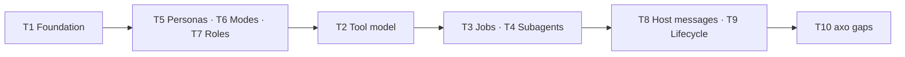

# Axome plan: adopting axo

This is the live planning document for adopting axo `843cd73` in Axome. It changes freely as we work.

- **Goals & settled decisions:** [`design.md`](design.md)
- **Evidence:** [`research/`](research/README.md) (axo surveys, file:line cited)

## How we work

- **One topic at a time**, in the order of the table below. For each topic: re-read its facts, answer its questions, record each answer as a decision in [`design.md`](design.md), then mark the topic **Decided**.
- **Questions keep their IDs** (Q1–Q43) for the whole adoption, so notes and commits can refer to them. New questions get the next free number.
- **Facts come from axo source, not its docs.** If axo moves, re-survey the affected area into `research/axo-<rev>/` and update the facts here.
- **When a question needs axo work**, add it to [T10](#t10-remaining-axo-gaps) so requests to axo go out in batches.
- **Implementation starts per topic** once its decisions are recorded; the [mechanical migration](#mechanical-migration) can start as soon as T1 is decided.

## Topics

| Topic | Scope | Questions | Order | Status |
|---|---|---|---|---|
| [T1](#t1-foundation-config-storage-construction) | Config, storage, construction, supervision | Q1–Q4 | 1 | Open |
| [T2](#t2-tool-model) | `kill`, `send`, `call`, deferred tools, tool cards, approval | Q5–Q10 | 3 | Open |
| [T3](#t3-background-jobs) | Job surface, live output, wakes, closing with running jobs | Q11–Q16 | 4 | Open |
| [T4](#t4-subagents-and-teams) | Children, teams, steering, results, sidebar | Q17–Q24 | 4 | Open |
| [T5](#t5-personas) | Root agent per conversation, switching, authoring | Q25–Q28 | 2 | Open |
| [T6](#t6-modes) | Plan mode, review, mode UI, user modes | Q29–Q35 | 2 | Open |
| [T7](#t7-models-and-roles) | `@role` selectors, roles UI, model picker | Q36–Q37 | 2 | Open |
| [T8](#t8-host-messages-sections-dynamic-tools) | What Axome tells the model, custom message rendering | Q38–Q39 | 5 | Open |
| [T9](#t9-session-lifecycle-and-status) | Context meter, cost, unloading, live-session registry | Q40–Q42 | 5 | Open |
| [T10](#t10-remaining-axo-gaps) | axo gaps: accept, work around, or request | Q43 | 6 | Open |

T5–T7 go together because they define the composer and the `/plan` story; T3 and T4 go together because jobs and children share one registry and probably one surface.

## Vocabulary

- **Persona:** the root agent definition. Replaces the system prompt body and shapes the tool set. Switched with `Session::set_agent`.
- **Mode:** an overlay on a root session. Adds instructions as a hidden message, limits which tools may run, may switch model on entry, and may end with the model handing back a result. Switched with `Session::set_mode`. Leaves the system prompt alone.
- **Model role:** `@name` in a model selector, mapped to a concrete model in user settings. `@plan` is a role, not an agent.
- **Deferred tool:** a tool the model can run but whose schema is not in the declared tool list. The model finds it through `tool://` and runs it through the `call` tool.
- **Job:** a row in a session's job registry: a background command (`bg_N`) or a child session (`agent_N`).

---

## Mechanical migration

Compile and correctness fixes with nothing to decide beyond T1. Evidence: [`research/axo-843cd73/compile-probe.md`](research/axo-843cd73/compile-probe.md) (38 errors: 28 production, 10 tests).

- [ ] Construction: `Axo::builder(models, store)`, sync `build()`, `ConfigSource`; Axome keeps its own `Models` and settings (shape decided in T1).
- [ ] Exhaustive matches: entries `job_start`, `child_start`, `job_end`, `agent_change`, `mode_change`; events `Job`, `JobGone`, `Context`, `AutoPaused`, `Mode`, `ModeResult`, `ModeResultResolved`; submission kinds `Mail`, `Quiet`; `CommandKind::Mode`; the new error variants in `axo_error`.
- [ ] Flat `LiveSnapshot` (`snapshot.agent` is now the persona name).
- [ ] `abort()` is sync; `NavigateOptions.focus`; `ModelsOptions.http_client` in tests.
- [ ] Drop `lastLinePartial` from `payload.ts` and its test fixture (capped read/grep/find output currently loses structured rendering).
- [ ] Forward `details` on partial tool updates (`live.rs:410-423`).

How each new entry, event and message renders is decided in its topic; the migration only makes the matches explicit.

---

## T1. Foundation: config, storage, construction

**Status:** Open · **Evidence:** [`research/axo-6cdaeb4/config-and-embedding.md`](research/axo-6cdaeb4/config-and-embedding.md)

**What axo gives**
- `Axo::builder(Arc<Models>, Arc<dyn SessionStore>)` with `.config(ConfigSource)`, `.cache_dir`, `.name`, `.supervision`. axo no longer reads `~/.axo`.
- `ConfigSource` supplies `user()` and `project(cwd)` layers, including agent roots and mode roots. axo owns the settings schema, merging, trust filtering and `$VAR` expansion; user-only keys (`modelRoles`, `subagents`, `homeAgentsDir`, `project`) are ignored in project layers. `user()` is sampled at session create and open; there is no hot reload.
- No cache dir means no bundled docs scheme and no Nix dev-shell capture.
- `.name("axome")` renames the harness in the bundled prompts and the docs scheme (`axome://`).
- Supervision: process group (default, nothing to ship) or cgroup v2 (Axome's binary must route a supervisor entry in `main()`, and needs a delegated cgroup).
- axo-ai: Axome owns `Models`; config values starting with `!` are rejected, so command-based secrets resolve in Axome.

**Questions**
- **Q1.** Where do settings, models, credentials, sessions and cache live in Axome's data dir, and what happens to existing `~/.axo` sessions and `auth.json`: import once, read in place, or ignore?
- **Q2.** Harness name: call it `axome` in prompts and the docs scheme, or keep `axo`?
- **Q3.** Supervision: process group or cgroup?
- **Q4.** Settings UI scope: which axo settings Axome surfaces (retry, `bash.promoteAfterMs`, `subagents.*`, `modelRoles`), and where project trust decisions come from.

**Decisions:** none yet.

---

## T2. Tool model

**Status:** Open · **Evidence:** [`research/axo-843cd73/tools.md`](research/axo-843cd73/tools.md)

**What axo gives**
- **`kill`** (`{id}`, `bg_N` or `agent_N`) and **`send`** (`{to, message, steer?}`) are tools; `proc://` and `agent://` are read-only. Killing a child stops its current run, not the child. No team-wide kill.
- **`call`** runs a deferred tool (`{tool, args}`). One call has two names: the assistant's tool call is `call`; execution events and the tool result carry the inner tool's name, with the same call id.
- **`tool://`** lists deferred tools; reading `tool://<name>` describes one and asks axo to promote it into the declared list on models that support mid-conversation tool changes. A hidden `tool_catalog` message tells the model when the deferred set changes.
- **Host tools:** `SessionOptions.tools: Vec<HostTool>`, each `HostTool::direct` or `HostTool::deferred`. Axome registers none today.
- **`ToolPolicy`** (replaces `tool_hooks`): async `before_tool_call` (Allow or Block; no argument rewrite) and `after_tool_call`, with a `ToolScope` (session, depth, persona, mode). Children inherit policies. No built-in approval protocol; a host builds one by awaiting inside the policy.
- **Result `details`:** bash `{exit, durationMs, fullOutput?}`, or `{job, fullOutput}` when promoted; spawn `{job}` or `{team, jobs}`; wait `{jobs}`; read, edit and write carry a ledger record. `kill`, `send` and `yield` have none.

**Where Axome stands**
- Tool cards are chosen from the assistant block's name (`turns.ts:69-80`), so every dispatched tool renders as a generic `call` card.
- `kill`, `send`, `spawn`, `wait`, `yield`, `enter_mode` and `call` have no cards.
- Bash footer parsing does not know the new stop wording; the typed `exit` makes the parsing unnecessary.

**Questions**
- **Q5.** Dispatched calls: show the inner tool's card (with a "via call" mark) or the outer `call`?
- **Q6.** Card set: which new tools get dedicated cards, and do job-related cards (promoted bash, spawn, wait, kill, send) link into the jobs and agents surface instead of repeating it?
- **Q7.** Replace bash footer text parsing with the typed `exit` and `durationMs`?
- **Q8.** Tool approval: do we want a permission system (per tool, per persona, per mode, per child), and what does the prompt look like? A whole feature, enabled by `ToolPolicy`.
- **Q9.** Host tools: which tools of its own does Axome offer the model (open in editor, show diff, notify, task list), and which are direct or deferred?
- **Q10.** Deferred catalog: user-visible anywhere, given a host read of `tool://<name>` triggers promotion?

**Decisions:** none yet.

---

## T3. Background jobs

**Status:** Open · **Evidence:** [`research/axo-843cd73/host-surface.md`](research/axo-843cd73/host-surface.md), [`research/axo-6cdaeb4/jobs.md`](research/axo-6cdaeb4/jobs.md)

**What axo gives**
- Per-job events (`Job(JobInfo)` upsert, `JobGone`) and `snapshot.jobs`. A row has id, status (`Queued`, `Running`, `HelpersRunning`, `Finished`, `Failed`), `call_id`, `started_at`, and messages with delivery state. Command rows add label, tool, cwd, artifact, promotion cause and time, end time, and a typed exit (`exited`, `signaled`, `timedOut`, `killed{by}`, `aborted`, `interrupted`).
- `Session::command_output(call_id)`: a byte-offset progress watch plus range reads, continuous from foreground through promotion to exit. stdout and stderr are merged. Not restored after reopen; the artifact file stays readable.
- `Session::background(call_id)` (the user's "send to background") and `Session::kill_job(id)`.
- `jobs_from_entries(header, entries)` for closed sessions. A command that never ended shows as `Running` there until the session is opened and reconciled.
- Finished jobs wake an idle session and arrive as a `job_result` custom message whose details list the delivered message refs.
- `AutoPaused` event: job wakes are suppressed after an error or abort.

**Questions**
- **Q11.** Where jobs live in the UI: session bar, side panel, dock, or expandable inline cards. Per session only, or also a window-wide view across tabs?
- **Q12.** Terminal view: live output from the merged stream; scrollback size; what it shows after reopen (the static artifact).
- **Q13.** Delivered results in the transcript: today a muted notice. A proper "bg_1 finished" element linked to its row?
- **Q14.** The wake: a finished job starts a turn on its own. How the UI makes that legible, and how auto-pause is shown and cleared.
- **Q15.** Closing a tab or the app with running jobs: stop, keep the session alive, or block. Axome's idle unload would drop the session, which stops its commands and children [INFERENCE: read from code, not run].
- **Q16.** History views: how to label "was running when the session closed".

**Decisions:** none yet.

---

## T4. Subagents and teams

**Status:** Open · **Evidence:** [`research/axo-843cd73/host-surface.md`](research/axo-843cd73/host-surface.md), [`research/axo-6cdaeb4/agents.md`](research/axo-6cdaeb4/agents.md)

**What axo gives**
- Children are job rows (`JobKind::Child`): session id, path, depth, persona, model, team ref, `resident`, and progress (`turns`, `max_turns`, `wrapping_up`, `yield_failures`, `usage`), pushed after each child assistant message. `Queued` is a real status.
- `Axo::session(child_id)` returns the live child; `child.attach()` is the same stream as a root, so a child renders as a chat and accepts steer, follow-up and abort.
- Host spawn: `Session::spawn`, `spawn_team`. `SpawnHook` (Allow, Block, Replace) for policy.
- Durable: `JobEnd.value` (typed yield result), `JobEnd.usage`, notes vs results, mail with sender.
- Opening a child file directly fails with `ChildSession { root }`; the host opens the root, then asks for the child. Read-only open works without the root.
- Not exposed: current tool and latest text on the parent row, queue position, live team state (who waits, pending mail, mutual wait), teammate mail and parent notes from the host, dismissing a row, tree usage rollup.

**Questions**
- **Q17.** Mental model: children as nested conversations (tree in the sidebar), rows in an agents panel, tabs, or split panes? What does a team look like?
- **Q18.** Depth of the live view: parent-row progress only, or attach each visible child for current tool and streaming text?
- **Q19.** User control: steer, follow up, stop a child run; can the user spawn a child, and from where?
- **Q20.** Results: how a child's result and structured value appear in the parent transcript, and how the user gets from the result to the child's transcript.
- **Q21.** Sidebar and history: child sessions appear in `list_sessions`; hide them, nest them under the root, and what a click does when the root is closed.
- **Q22.** Spawn approval: does `SpawnHook` drive a UI (confirm, pick the model, replace the agent) or stay silent?
- **Q23.** Cost: per-child and whole-tree usage (Axome sums it).
- **Q24.** Agent definitions: where they live (app data, project, both), whether Axome ships any, and whether there is an editor.

**Decisions:** none yet.

---

## T5. Personas

**Status:** Open · **Evidence:** [`research/axo-843cd73/host-surface.md`](research/axo-843cd73/host-surface.md)

**What axo gives**
- `agent_change` entry; reopen restores the persona by name from the definitions loaded at that time. A missing definition gives a diagnostic and the session runs without it.
- `Session::set_agent(name | None)`: root only, allowed during a run, applies from the next request, and applies the persona's model selector if it has one. Clearing does not restore the previous model.
- `runAs: root | subagent | any` on definitions.
- `Axo::catalog(cwd, access, agents, modes)` lists agents, teams, modes, config and diagnostics without a session.
- Forks inherit the current persona.

**Questions**
- **Q25.** Is the persona a per-conversation choice (picker in composer or header), a per-project default, a global default, or all three?
- **Q26.** Does Axome ship a default persona of its own (its own system prompt)?
- **Q27.** Switching mid-conversation: how the transcript marks it, and how the user learns the model may change with it.
- **Q28.** Where personas are authored and stored, and their relation to T4's agent definitions (same files; `runAs` decides where each appears).

**Decisions:** none yet.

---

## T6. Modes

**Status:** Open · **Evidence:** [`research/axo-843cd73/modes.md`](research/axo-843cd73/modes.md)

**What axo gives**
- Definitions are markdown with frontmatter: `name`, `description`, `argument-hint`, `disable-model-invocation`, `model`, `tools.allow`, `tools.deny`, `result.schema`, `result.review`, `result.then`, plus free extra keys for host policy. Roots come from `ConfigSource` or `SessionOptions`. axo ships none.
- Enter with `Session::set_mode(Some(name))`, the `/name [prompt]` command through `Session::parse_command`, or the model's `enter_mode` tool (unless the mode disables model invocation). Leave with `set_mode(None)` or by the model finishing through `yield`.
- Effects: a hidden `mode_notice` message carrying the body; tool limits enforced at call time by tool name (not a shell sandbox); model and thinking switched on entry and restored on exit unless the user changed the model in between.
- Result review: with `result.review`, `yield` waits; the host gets `ModeResult { call_id, mode, result, awaiting_review }` and answers with `accept_result(call_id, message?)`, `revise_result(call_id, feedback)` or `dismiss(call_id)`. No way to accept an edited result. Pending reviews are in memory only. `result.then`, or the accept message, continues the run.
- State: the `mode_change` entry follows the branch; `SessionEvent::Mode`, `snapshot.mode`, `snapshot.pending_results`. These report the selected mode; nothing signals when it takes effect.
- Children spawned in a mode inherit its tool limits as a permanent ceiling, not its instructions.
- Mode and persona are independent; a mode cannot select a persona.

**Where Axome stands**
- `Command::decode` does not know modes; dispatch goes through `parse_command` or `set_mode`. The composer labels every non-builtin command as a skill.

**Questions**
- **Q29.** Which modes Axome ships (plan first), and what plan mode is: read-only tools, a `@plan` model role, a reviewed result that is the plan.
- **Q30.** "Plan mode with a plan agent": mode only, mode plus a persona switch (Axome does both), or persona only. Decides whether the system prompt changes.
- **Q31.** Review UI: where the plan is shown; approve, ask for changes, dismiss; what approval continues with (implement now, new session, hand to a child).
- **Q32.** Does the approved plan persist as its own object? axo keeps it only as the tool call's arguments.
- **Q33.** Mode indicator and exit control in the composer; how model-initiated entry (`enter_mode`) is shown or gated.
- **Q34.** Read-only really meaning read-only: tool-name limits still allow `bash`. Deny bash in plan mode, or add a `ToolPolicy`?
- **Q35.** User-defined modes: supported, where stored, and how they sit in the `/` picker next to skills and built-ins.

**Decisions:** none yet.

---

## T7. Models and roles

**Status:** Open · **Evidence:** [`research/axo-6cdaeb4/agents.md`](research/axo-6cdaeb4/agents.md), [`research/axo-843cd73/modes.md`](research/axo-843cd73/modes.md) §1.5

**What axo gives**
- Selectors: `provider/model`, `@role`, `:thinking`, and combinations. `modelRoles` is a user-only setting. Personas, modes and `subagents.models` all take selectors.

**Questions**
- **Q36.** A roles screen in settings (default, plan, fast, …): which roles Axome defines and what uses them.
- **Q37.** The model picker offers concrete models only today; show roles too?

**Decisions:** none yet.

---

## T8. Host messages, sections, dynamic tools

**Status:** Open · **Evidence:** [`research/axo-843cd73/host-surface.md`](research/axo-843cd73/host-surface.md)

**What axo gives**
- `Session::post(HostMessage { custom_type, text, display, delivery: Steer | FollowUp | Quiet })`: durable; `Quiet` never starts a run. Seven engine custom types are reserved.
- `set_section(name, body | None)` and `set_tools(...)`: root only, apply from the next request, must be supplied again on reopen.
- No `prepare_request` hook for hosts.

**Where Axome stands**
- Axome's notice wire type keeps only text, so job results, mail, notes and host messages all look alike.

**Questions**
- **Q38.** What Axome tells the model on its own (open file, selection, git state, UI events), and through which channel: quiet message, prompt section, or nothing.
- **Q39.** Rendering custom messages: how job results, mail, child notes and host messages are told apart.

**Decisions:** none yet.

---

## T9. Session lifecycle and status

**Status:** Open · **Evidence:** [`research/axo-843cd73/host-surface.md`](research/axo-843cd73/host-surface.md)

**What axo gives**
- Context meter: `ContextUsage { tokens, window, trigger, reserve }` with `Context` events. Axome currently derives context from the last response's token count.
- Cumulative usage in the snapshot; per-run usage on `run_end`.
- `run_end.queued`: queued input survives reopen and is requeued without starting a run by itself.
- `/compact` and `/navigate` take a focus; compaction entries record reason and focus.
- No process-wide events on `Axo` and no list of live sessions.

**Questions**
- **Q40.** Context meter and cost display in the session bar.
- **Q41.** When Axome may unload a session, now that a session owns jobs and children (ties to Q15).
- **Q42.** Does Axome keep its own registry of live sessions for a window-wide activity view?

**Decisions:** none yet.

---

## T10. Remaining axo gaps

**Status:** Open · **Evidence:** [`research/axo-843cd73/host-surface.md`](research/axo-843cd73/host-surface.md) §7–8, [`research/axo-843cd73/modes.md`](research/axo-843cd73/modes.md) §7, [`research/axo-843cd73/tools.md`](research/axo-843cd73/tools.md) §7

Axome's 35-point request for a typed host surface (made against axo `6cdaeb4`) came back 14 shipped, 16 partly, 3 not shipped, 2 decided differently. What remains:

| Gap | State in axo | Axome impact |
|---|---|---|
| Ordered, timestamped event envelope | Not shipped; events are bare, only entries have seq and time | Re-attach still resyncs; a `Job` event can arrive before its `job_end` entry |
| Process-wide events, live session list | Not shipped | Axome keeps its own registry (Q42) |
| stdout/stderr separation | Merged stream | Terminal view cannot color stderr |
| Opening a child whose root is closed | Host opens root, then child | Axome orchestrates it (Q21) |
| Child row: current tool, latest text, queue position | Partly; turns and usage only | Attach children for rich rows (Q18) |
| Team live state, host mail and notes, dismissing a row | Partly | Team UI is roster plus per-child state |
| Command output after reopen | Artifact file only | Static view for old jobs (Q12) |
| Tree usage rollup | Per-run usage only | Axome sums (Q23) |
| Prompt and tool introspection with origin, config provenance, file ledger listing | Not shipped or partly | No "what the model sees" panel without more axo work |
| Host `prepare_request` hook, retry detail | Not shipped | Sections and quiet messages instead (Q38) |
| Mode: effective-mode signal, accept an edited result, durable review record | Not present | Shapes Q31–Q33 |
| Typed deferred-tool catalog | Not present | Shapes Q10 |
| Typed `kill`/`send` receipts, dispatch provenance on events | Not present | Shapes Q5–Q6 |

**Questions**
- **Q43.** For each row: live with it, work around it in Axome, or send it back to axo before designing the UI that depends on it. Answer per row once the topics that depend on it are decided.

**Decisions:** none yet.
